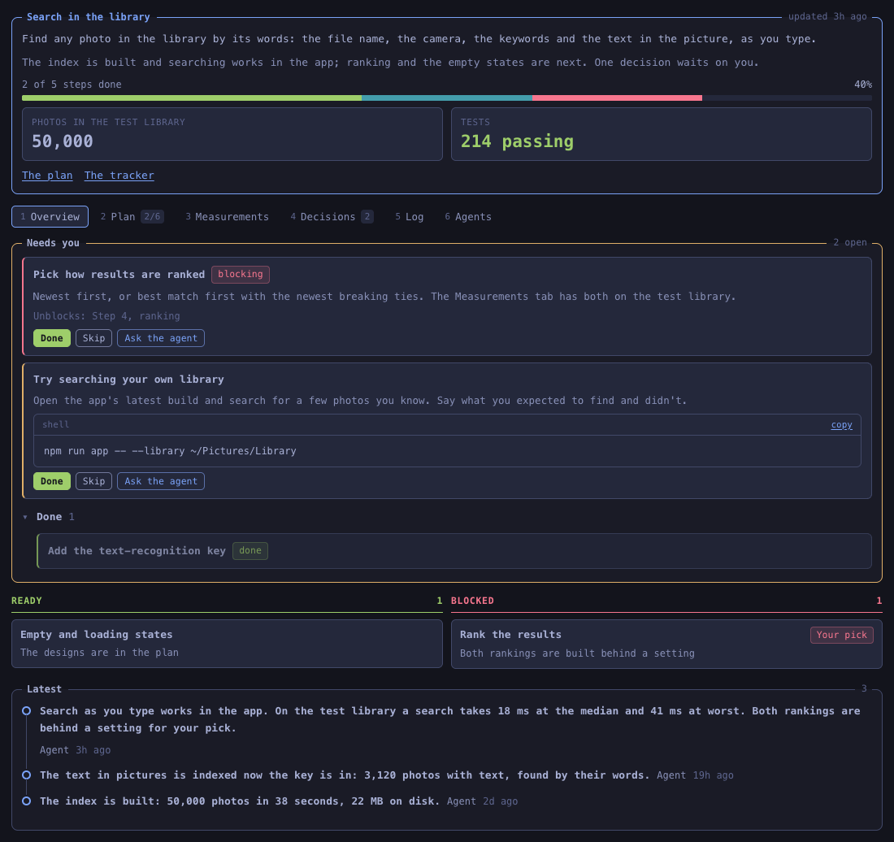
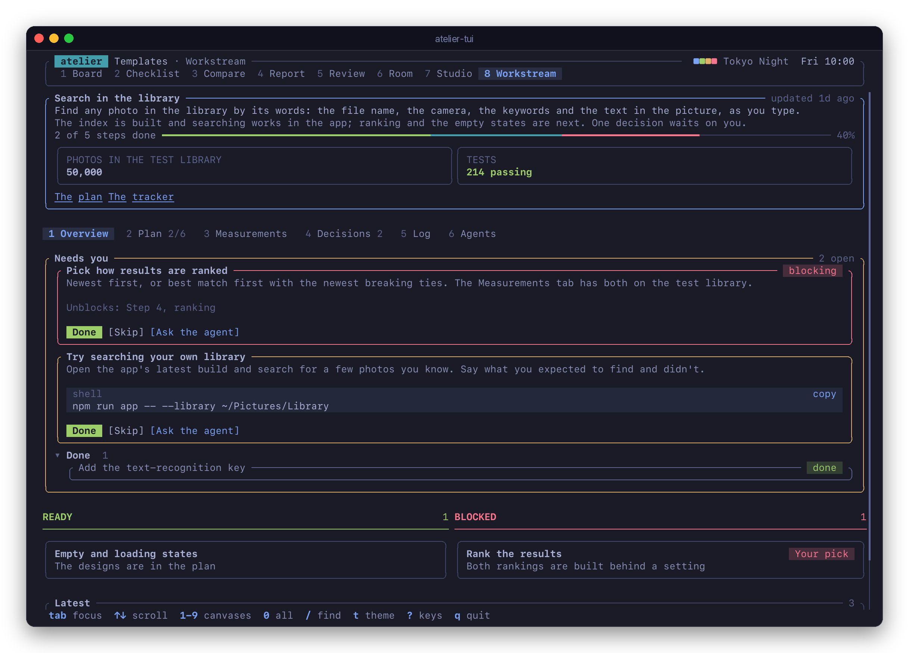
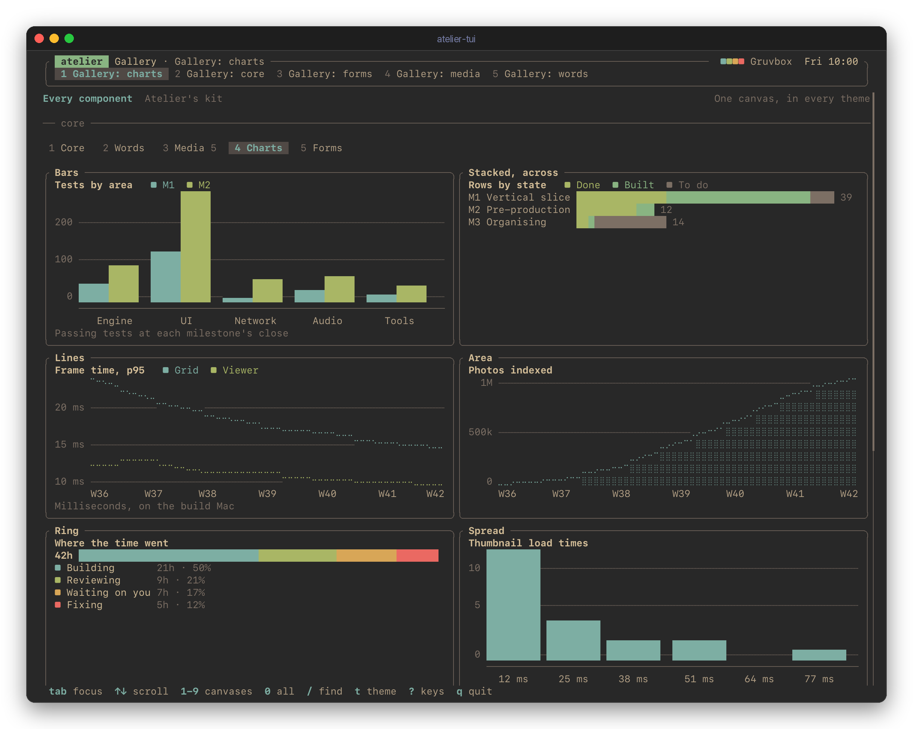
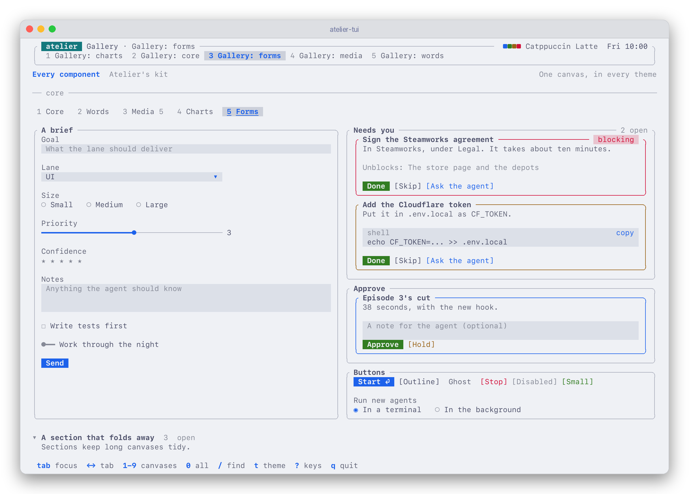
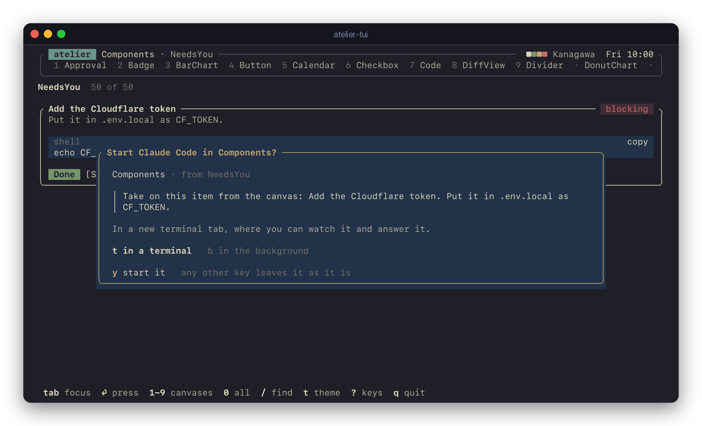
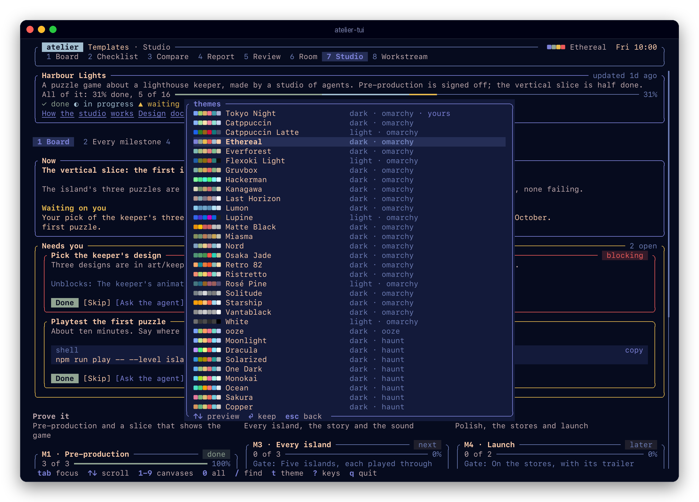
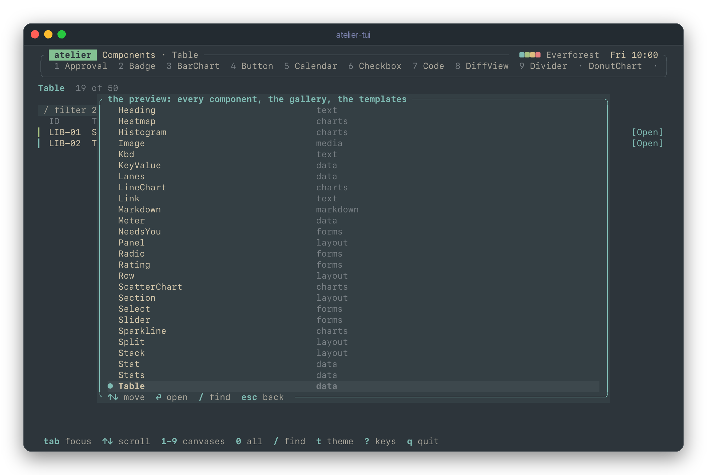

# Atelier

Themeable canvases for Claude Code. An agent writes a canvas, a live view of its work: a workstream, a studio of agents, a review, an approval room. You open it in your browser beside the terminal, or in the terminal itself. It updates as the agent works, it keeps what you mark on it, and its buttons start, resume and message the agents.


Claude Code writes a canvas and you see it live, in your browser or in a terminal beside Claude Code. Claude can read what you do on it, or wait for your answer.

## What it does

- **Rich canvases.** Tables, stats, charts, forms, images and video, from one kit, in one look.
- **Templates for what recurs.** A workstream, a studio of role agents, an approval room, a board, a checklist, a review, a comparison and a report. An agent fills in data instead of writing UI.
- **Themes.** Omarchy's look, with its 23 palettes and 54 more, ooze's among them. Every canvas follows the theme you pick.
- **Agent loops.** Mark something done, approve a cut or answer a form, and the agent sees it. Start a session from a button, in a terminal or in the background, and watch it work.
- **In the browser or the terminal.** The same canvases, with every component and every theme, in a browser tab or in atelier-tui, a terminal viewer in ooze's look, with images where the terminal can draw them.
- **Sealed off.** A canvas runs with no network, in a sandboxed frame in the browser and in a sealed engine in the terminal, and nothing it asks for runs until you confirm it.

## Install

In Claude Code, add this repository as a plugin marketplace and install the plugin:

```text
/plugin marketplace add pdcgomes/atelier
/plugin install atelier@atelier
```

Then install the `atelier` command, which the plugin's hooks and tools run:

```sh
npm install -g @pdcgomes/atelier
```

Without it, the plugin falls back to `npx`, which works but is slower on every hook. Atelier needs Node.js 22 or later, and Claude Code for its agent loops.

On a Mac, then run this in your own Terminal:

```sh
atelier install
```

It keeps atelier's daemon running as a LaunchAgent in your login session. Without it, the plugin starts the daemon from inside Claude Code when it's needed, and a daemon started there runs in Claude Code's sandbox, which won't let it open your browser or a terminal tab. Run it again after updating atelier, and `atelier uninstall` to take it away.

To see canvases in a terminal as well, install atelier-tui, which is built with Rust:

```sh
cargo install --git https://github.com/pdcgomes/atelier atelier-tui --locked
```

## Start

Ask Claude Code for a canvas: "make a workstream canvas for this", "show me the benchmark results on a canvas", "ask me on a canvas which of these designs I prefer". It writes the canvas in the project's `.atelier/` folder, Atelier checks it, and it opens in your browser. Keep the tab open: each canvas the agent writes or changes appears there as it's saved. Or run `atelier tui` in a terminal beside Claude Code, and it appears there instead.



You can also start one yourself:

```sh
atelier new workstream search       # from a template's example, in .atelier/search.canvas.json
atelier new custom scratch          # a TSX canvas of your own
atelier open                        # the viewer, with every canvas
atelier tui                         # the viewer in this terminal
```

## Templates

| Template | For |
| --- | --- |
| `workstream` | One line of work: its goal, the plan's steps, what needs you, what's ready or blocked, decisions, the log and measurements |
| `studio` | A studio of agents making something big: milestones by phase, every deliverable's state, the roles, how work moves, the agents |
| `room` | Pieces of work moving through stages to your approval and out to their channels, with their images and words |
| `board` | Columns of cards, with a list that sorts and filters |
| `checklist` | Groups of things to tick, for a release or a launch |
| `review` | Findings by severity, with where each is, what's proposed and a diff, and your call on each |
| `compare` | Options side by side against weighted criteria, with a recommendation and your pick |
| `report` | Headline numbers, then sections of text with charts, tables and images |

Each one's fields and example are in [`templates/`](templates). A custom canvas can draw a template and add to it: `import { Studio } from "atelier/templates"`.

<p>
  
  
</p>
<p>
  
  
</p>

## In the browser

A bar along the top, like Waybar: the project's canvases as numbered workspaces, what its agents are doing, background runs, the clock and the theme.

| Key | What it does |
| --- | --- |
| `1` to `9` | Switch to this project's canvases |
| `0` | Every canvas, by project |
| `/` | Find a canvas |
| `t` | Pick a theme, previewed as you move |
| `r` | Background runs, step by step |
| `?` | The keys |

When a canvas asks to start an agent, message one or open a file, the viewer shows you exactly what it will do, and does it only when you confirm.

<p>
  
  
</p>

## In a terminal

If you work with Claude Code in a terminal, `atelier-tui` shows the same canvases there, beside it: every component of the kit, every template, and the canvases agents write, in every theme. It looks like [ooze](https://github.com/pdcgomes/ooze), and it's a viewer as the browser is: a canvas an agent shows switches it, what you do on it is saved for the agent, and nothing a canvas asks for runs until you say yes.



Once it's [installed](#install):

```sh
atelier tui                       # this project's canvases
atelier tui .atelier/plan.canvas.json
```

With `"viewer": "terminal"` in `~/.atelier/settings.json`, a canvas shown while no viewer is open opens in a terminal tab instead of the browser.

<p>
  
  
</p>
<p>
  
  
</p>

| Key | What it does |
| --- | --- |
| `1` to `9`, `0`, `/`, `t`, `r`, `?` | As in the browser: canvases, every canvas, find, themes, runs, the keys |
| `tab`, `shift-tab` | The next thing you can press, type in or pick; the panel it's in lights up |
| `⏎`, `space` | Press it, tick it, open it |
| `←` `→`, `[` `]` | Tabs, options, sliders, ratings, months; the canvas's tabs |
| `↑` `↓`, `pgup` `pgdn` | Scroll, or move in a table |
| `o` | The canvas in the browser |

Images are drawn with the Kitty graphics protocol in Ghostty, kitty and WezTerm, with iTerm2's inline images in iTerm2, with Sixel in foot, Windows Terminal and xterm, and in half blocks anywhere else. `ATELIER_IMAGES=kitty|iterm|sixel|blocks` says which. Videos and PDFs open in their own app.

### The preview harness

`atelier-tui demo` shows every component on its own, the gallery, every template's example and the other examples, without a daemon, from the fixtures `node scripts/fixtures.mjs` writes. `--snapshot` prints one frame, after `--keys`, as text or, with `--ansi`, in colour; `scripts/capture.py` makes the pictures above from those frames.

```sh
node scripts/build.mjs && node scripts/fixtures.mjs
cargo run --manifest-path tui/Cargo.toml -- demo                    # every component, the gallery, the templates
cargo run --manifest-path tui/Cargo.toml -- demo component-Table --theme gruvbox
cargo run --manifest-path tui/Cargo.toml -- demo workstream --snapshot --width 120 --height 40
python3 scripts/capture.py          # the README's pictures; --all draws every fixture in two themes
```



Every component the kit has is drawn in the terminal, and a component the kit gains has to be: [docs/design.md](docs/design.md#every-component-now-and-later) says how that's checked.

## How it works

- Agents write canvases into `.atelier/` in the project: TSX for anything custom, or JSON for a template.
- A small daemon on your machine compiles and checks them, serves the viewer at `127.0.0.1`, and keeps what you do on each canvas beside it, in `<name>.state.json`.
- atelier-tui reaches the same daemon as the browser does, and runs each canvas in a sealed engine of its own, with the same code: the kit's components, drawn for a terminal.
- The Claude Code plugin teaches agents to write canvases, checks each one they write and hands its problems back, tells the daemon what each session is doing, and gives agents MCP tools to show a canvas and wait for your answer on it.

### How Claude sees what you did

When you tick an item, approve a change or send a form, in the browser or in a terminal, the daemon saves it in the canvas's `<name>.state.json`, with a timestamp. No hook fires on your click: Claude Code runs hooks only at its own events. So Atelier passes it on at these points, to each session that wrote the canvas:

- **When you send a prompt,** Claude gets a few lines with it saying what you've done since it was last told.
- **When Claude's turn ends,** anything you did while it worked is handed over, and Claude continues the turn to act on it.
- **When a session resumes,** it is told what you did since it stopped, as long as it keeps the same ID.
- **In the middle of a turn,** Claude can wait on `canvas_wait` until you answer. What it gets that way isn't repeated by the hooks.

It costs almost nothing:

- **No polling.** Claude never checks the canvases on its own. The hooks are the ones Atelier already runs to track sessions, and each reads the event logs of the session's canvases, on your machine. The only extra model work is when a turn ends with news: Claude carries on with it.
- **No tokens when nothing changed.** Apart from one line at session start naming the project's canvases, a hook adds context only when something changed: a line for each change, twelve at most. View state, such as the open tab, the sort order or an unsent draft, is left out.
- **Waiting costs no tokens.** While Claude waits on `canvas_wait`, it isn't generating anything. The call returns when you answer, or after its timeout (10 minutes unless Claude asks for up to an hour), and Claude can wait again.
- **Only its own canvases.** A session is told only about the canvases it wrote, so sessions sharing a project don't fill each other's context.

## Commands

```text
atelier open [canvas]          Shows a canvas in the viewer, or the viewer itself
atelier tui [canvas]           The viewer in this terminal: atelier-tui
atelier new <template> <name>  Starts a canvas from a template, in this project's .atelier folder
atelier check <canvas>...      Builds, type checks and checks a canvas's rules
atelier state <canvas>         What you've done on a canvas: its state and the changes
atelier list                   The canvases the daemon knows
atelier templates              The templates there are
atelier themes                 The themes there are
atelier status | stop          The daemon
atelier install | uninstall    The LaunchAgent that keeps the daemon running, on a Mac
atelier hook <event>           For Claude Code's hooks
atelier mcp                    The MCP server, for agents
```

Settings, such as which terminal sessions open in and which editor files open in, are in `~/.atelier/settings.json`; [docs/design.md](docs/design.md#settings) lists them.

## From source

```sh
npm install
npm test                 # builds, then runs the tests, the browser ones in headless Chrome
node scripts/sea.mjs     # the single binary, build/sea/atelier, on an official Node.js
node scripts/fixtures.mjs && cargo test --manifest-path tui/Cargo.toml   # atelier-tui: every component drawn, its frames, its keys
```

## Docs

- [docs/design.md](docs/design.md): how it's built, the file formats, the kit, the daemon, the agent loops and the viewer in a terminal.
- [docs/security.md](docs/security.md): what a canvas can and can't do, in the browser and in a terminal, and why.

## Licence

MIT. Atelier's Omarchy themes are Omarchy's palettes, under Omarchy's MIT licence; [NOTICE](NOTICE) has the details.
