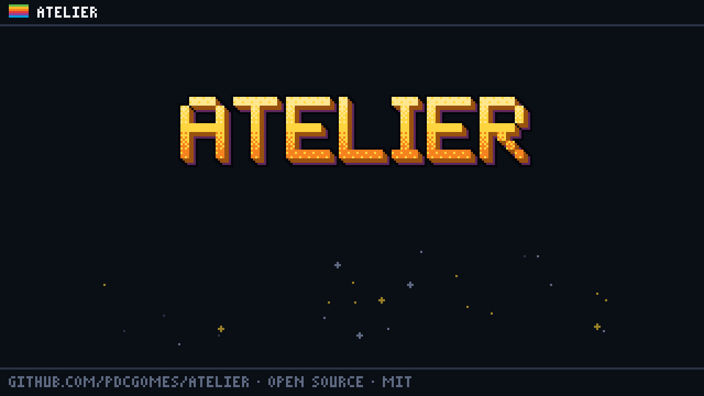
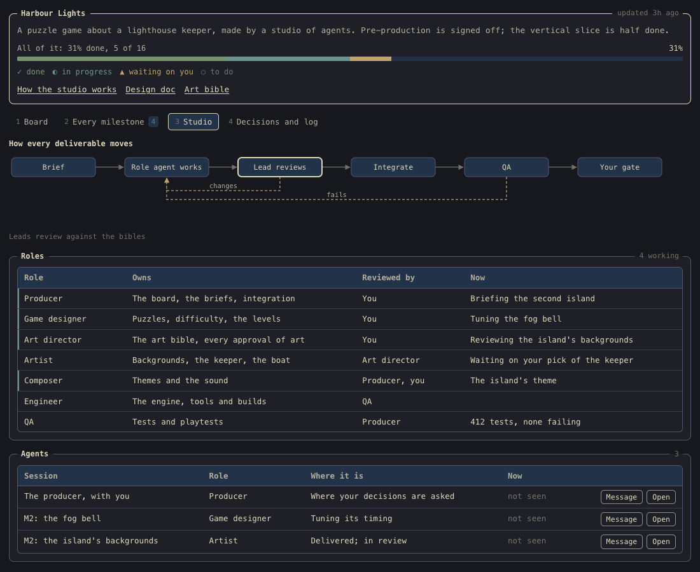
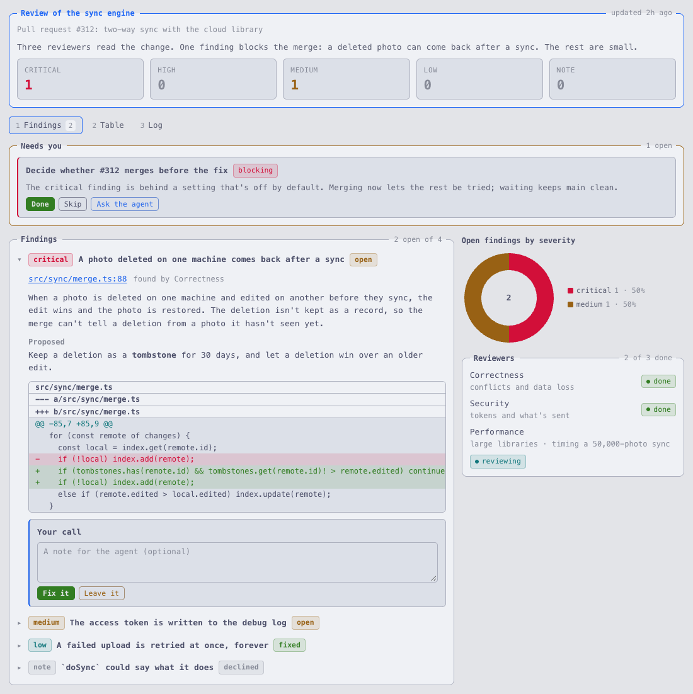
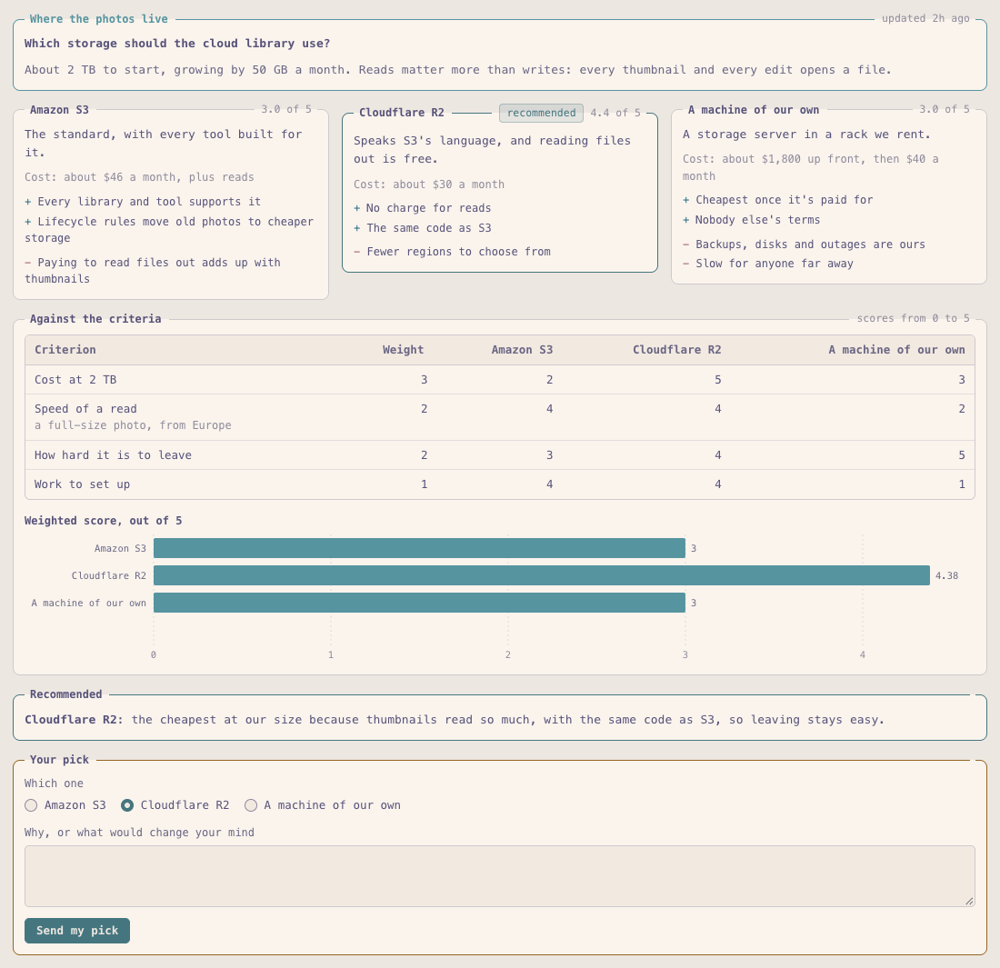
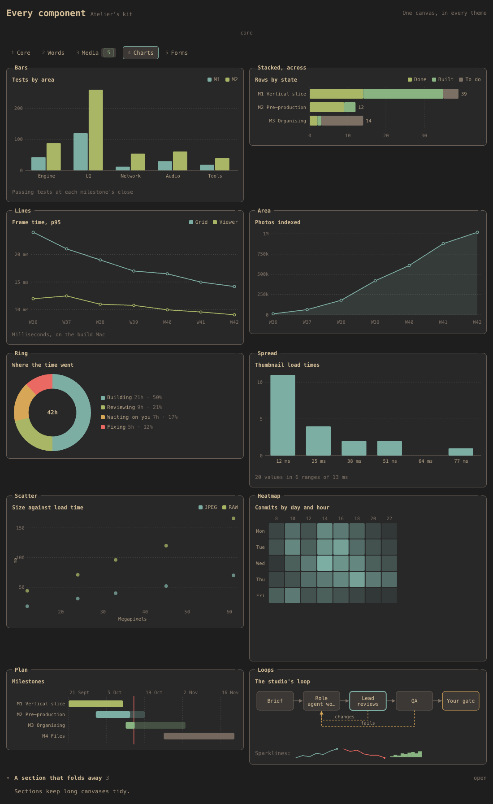
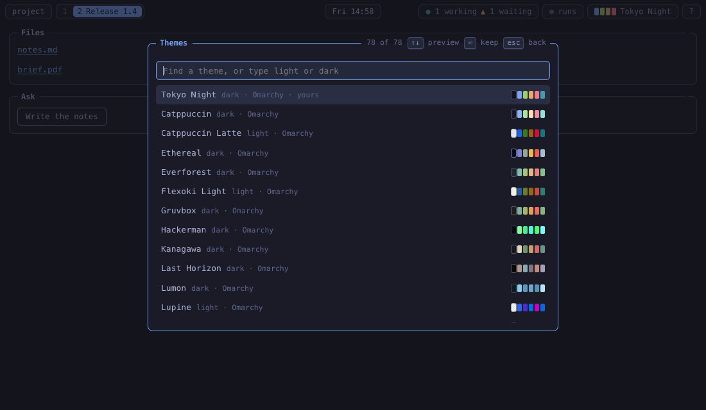
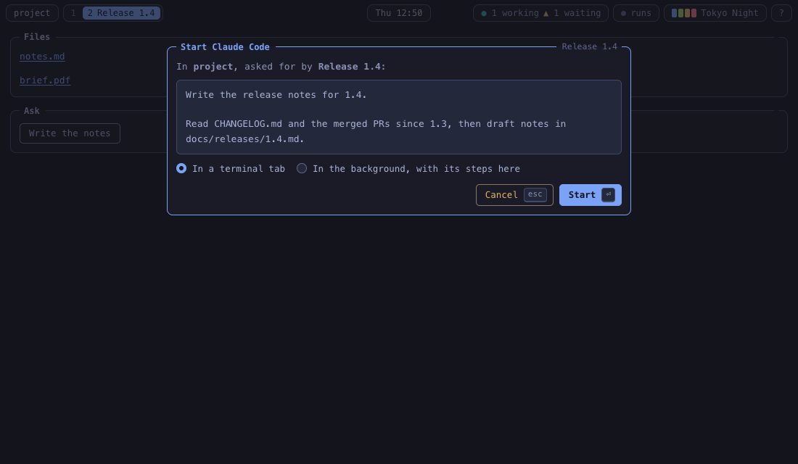

# Atelier

Themeable canvases for Claude Code. An agent writes a canvas, a live view of its work: a workstream, a studio of agents, a review, an approval room. You open it in your browser beside the terminal. It updates as the agent works, it keeps what you mark on it, and its buttons start, resume and message the agents.



Claude Code writes a canvas and you see it live in your browser. Claude can read what you do on it, or wait for your answer.

## What it does

- **Rich canvases.** Tables, stats, charts, forms, images and video, from one kit, in one look.
- **Templates for what recurs.** A workstream, a studio of role agents, an approval room, a board, a checklist, a review, a comparison and a report. An agent fills in data instead of writing UI.
- **Themes.** Omarchy's look, with its 23 palettes and 53 more. Every canvas follows the theme you pick.
- **Agent loops.** Mark something done, approve a cut or answer a form, and the agent sees it. Start a session from a button, in a terminal or in the background, and watch it work.
- **Sealed off.** A canvas runs in a sandboxed frame with no network, and nothing it asks for runs until you confirm it.

## Install

In Claude Code, add this repository as a plugin marketplace and install the plugin:

```text
/plugin marketplace add pdcgomes/atelier
/plugin install atelier@atelier
```

Then install the `atelier` command, which the plugin's hooks and tools run:

```sh
npm install -g @pdcgomes/atelier
```

Without it, the plugin falls back to `npx`, which works but is slower on every hook. Atelier needs Node.js 22 or later, and Claude Code for its agent loops.

## Start

Ask Claude Code for a canvas: "make a workstream canvas for this", "show me the benchmark results on a canvas", "ask me on a canvas which of these designs I prefer". It writes the canvas in the project's `.atelier/` folder, Atelier checks it, and it opens in your browser. Keep the tab open: each canvas the agent writes or changes appears there as it's saved.

You can also start one yourself:

```sh
atelier new workstream search       # from a template's example, in .atelier/search.canvas.json
atelier new custom scratch          # a TSX canvas of your own
atelier open                        # the viewer, with every canvas
```

## Templates

| Template | For |
| --- | --- |
| `workstream` | One line of work: its goal, the plan's steps, what needs you, what's ready or blocked, decisions, the log and measurements |
| `studio` | A studio of agents making something big: milestones by phase, every deliverable's state, the roles, how work moves, the agents |
| `room` | Pieces of work moving through stages to your approval and out to their channels, with their images and words |
| `board` | Columns of cards, with a list that sorts and filters |
| `checklist` | Groups of things to tick, for a release or a launch |
| `review` | Findings by severity, with where each is, what's proposed and a diff, and your call on each |
| `compare` | Options side by side against weighted criteria, with a recommendation and your pick |
| `report` | Headline numbers, then sections of text with charts, tables and images |

Each one's fields and example are in [`templates/`](templates). A custom canvas can draw a template and add to it: `import { Studio } from "atelier/templates"`.

<p>
  
  
</p>
<p>
  
  
</p>

## The viewer

A bar along the top, like Waybar: the project's canvases as numbered workspaces, what its agents are doing, background runs, the clock and the theme.

| Key | What it does |
| --- | --- |
| `1` – `9` | Switch to this project's canvases |
| `0` | Every canvas, by project |
| `/` | Find a canvas |
| `t` | Pick a theme, previewed as you move |
| `r` | Background runs, step by step |
| `?` | The keys |

When a canvas asks to start an agent, message one or open a file, the viewer shows you exactly what it will do, and does it only when you confirm.

<p>
  
  
</p>

## How it works

- Agents write canvases into `.atelier/` in the project: TSX for anything custom, or JSON for a template.
- A small daemon on your machine compiles and checks them, serves the viewer at `127.0.0.1`, and keeps what you do on each canvas beside it, in `<name>.state.json`.
- The Claude Code plugin teaches agents to write canvases, checks each one they write and hands its problems back, tells the daemon what each session is doing, and gives agents MCP tools to show a canvas and wait for your answer on it.

## Commands

```text
atelier open [canvas]          Shows a canvas in the viewer, or the viewer itself
atelier new <template> <name>  Starts a canvas from a template, in this project's .atelier folder
atelier check <canvas>...      Builds, type checks and checks a canvas's rules
atelier state <canvas>         What you've done on a canvas: its state and the changes
atelier list                   The canvases the daemon knows
atelier templates              The templates there are
atelier themes                 The themes there are
atelier status | stop          The daemon
atelier hook <event>           For Claude Code's hooks
atelier mcp                    The MCP server, for agents
```

Settings, such as which terminal sessions open in and which editor files open in, are in `~/.atelier/settings.json`; [docs/design.md](docs/design.md#settings) lists them.

## From source

```sh
npm install
npm test                 # builds, then runs the tests, the browser ones in headless Chrome
node scripts/sea.mjs     # the single binary, build/sea/atelier, on an official Node.js
```

## Docs

- [docs/design.md](docs/design.md): how it's built, the file formats, the kit, the daemon and the agent loops.
- [docs/security.md](docs/security.md): what a canvas can and can't do, and why.

## Licence

MIT. Atelier's Omarchy themes are Omarchy's palettes, under Omarchy's MIT licence; [NOTICE](NOTICE) has the details.
