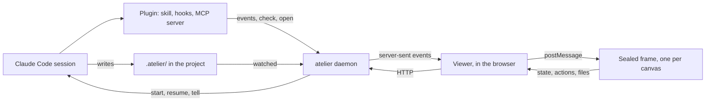

# Atelier's design

Atelier gives coding agents somewhere to show their work, and gives you somewhere to work from. An agent writes a canvas: a live view of a workstream, a team of agents, a review, a release, an approval queue. You open it in your browser, beside the terminal. It updates as the agent works, it keeps what you mark on it, and its buttons start, resume and message the agents.

It's built for Claude Code first. Nothing in it is specific to one agent except the plugin that connects them.

## Goals

- **Rich canvases:** layout, tables, stats, charts, forms and media, from one kit, with the same look everywhere.
- **Templates for what recurs:** a workstream, a studio of agents, an approval room, a board, a checklist, a review, a comparison and a report. An agent fills in data; it doesn't write UI.
- **Themes, with Omarchy's look:** panels with their titles in the border, gaps like a tiling window manager, monospace type, and 23 of Omarchy's palettes among the themes.
- **Agent loops:** a canvas is where you answer an agent, and where agents are started, resumed and told things.
- **Safe by default:** canvases are code an agent wrote, so they run sealed off from everything else.
- **Easy to install:** one npm package or one binary, and a Claude Code plugin.

Not goals: compatibility with any other canvas API, hosting canvases on the web, or several people sharing one.

## How it fits together



- **The daemon** is a Node.js process on 127.0.0.1. It watches canvas files, compiles and checks them, serves the viewer, keeps each canvas's state, reads the files canvases show, knows which agent sessions are running, and starts the ones a canvas asks for. The CLI starts it when it's needed.
- **The viewer** is a page the daemon serves. It holds the bar, the theme, and one sealed frame for the canvas on screen.
- **The frame** runs the canvas with the kit. It can't reach the network, the daemon or the page around it. It asks the viewer for what it needs: state, files and actions.
- **The plugin** connects Claude Code: a skill that teaches agents to write canvases, hooks that report sessions and check every canvas an agent writes, and an MCP server.

## Files

A project's canvases live in `.atelier/` at its root, because Claude Code edits its working directory without asking. Canvases that belong to no project go in `~/.atelier/canvases/`.

| File | Written by | What it holds |
| --- | --- | --- |
| `<name>.canvas.tsx` | The agent | A custom canvas: a module whose default export is a React component |
| `<name>.canvas.json` | The agent | A template's data: `{ "template": "workstream", ... }` |
| `<name>.state.json` | The viewer | What you did on the canvas: marks, approvals, picks, notes, form answers, the tab you're on |
| `<name>.events.jsonl` | The viewer | Each of those changes, appended with its time, so an agent can ask what's new |

Agents read the state and events files and never write them. A canvas's id is a short hash of its path; the viewer shows its name.

`~/.atelier/` holds the daemon's own files: `daemon.json` (its port, its token and its process), `settings.json`, `projects.json` (the roots it knows), `inbox.json` (messages waiting for sessions), `runs/` (the logs of background runs), `launch/` (the scripts terminal tabs run) and `cache/`.

## Canvases

A custom canvas is a TSX module:

```tsx
import { Panel, Stat, Row, useCanvasState } from "atelier";

export const meta = { title: "Release 1.4" };

export default function Release() {
  const [tab, setTab] = useCanvasState("tab", "overview");
  return (
    <Panel title="Release 1.4" info="3 of 5 done">
      <Row>
        <Stat label="Tests" value="1,269" tone="success" />
        <Stat label="Waiting on you" value="2" tone="warning" />
      </Row>
    </Panel>
  );
}
```

It may import from `atelier` and `react`, and from other files beside it in `.atelier/`. Nothing else: there are no packages to install and no network.

A template canvas is data:

```json
{ "template": "workstream", "title": "Library catalog", "goal": "…", "plan": [] }
```

Each template has a schema. `atelier check` validates the data against it, and the viewer draws it with the template's view. Templates are built from the same kit, so a custom canvas can use a template's view as a component and add to it.

## The kit

Everything a canvas uses comes from `atelier`:

- **Layout:** `Stack`, `Row`, `Grid`, `Panel`, `Tabs`, `Section`, `Divider`, `Split`.
- **Text and media:** `Heading`, `Text`, `Markdown`, `Code`, `Kbd`, `Link`, `Time`, `Image`, `Gallery`, `Video`. Images and videos are read from disk by path, never embedded.
- **Data:** `Table` (sorting, filtering, row tones, row actions), `Stat`, `Badge`, `Meter`, `KeyValue`, `Timeline`, `Lanes`, `Calendar`, `Tree`, `DiffView`.
- **Charts,** drawn as SVG: `BarChart` (grouped, stacked or horizontal), `LineChart` (lines or areas), `Sparkline`, `DonutChart`, `Histogram`, `ScatterChart`, `Heatmap`, `Gantt`, `FlowDiagram` (steps and loops, with labelled back edges). Every chart takes a `title`; it's required.
- **Forms:** `Button`, `Toggle`, `Checkbox`, `Radio`, `Select`, `TextInput`, `TextArea`, `Slider`, `Rating`, `Form`, `Approval` (approve or hold, with a note), `NeedsYou` (done, skip, or ask an agent).
- **Hooks:** `useCanvasState`, `useForm`, `useAction`, `useSessions`, `useTheme`, `useNow`.

Colours come only from the theme, through `tone` props (`accent`, `success`, `warning`, `danger`, `info`, `muted`) and the CSS variables below. `atelier check` refuses colour literals.

## Themes and the look

A theme sets these variables:

| Variable | Use |
| --- | --- |
| `--bg` | The page |
| `--panel` | A panel's inside |
| `--surface` | Raised things inside a panel: inputs, table headers, code |
| `--border`, `--focus` | Borders, and the border of what has focus |
| `--text`, `--text-2`, `--text-3` | Text, secondary text, and the dimmest text |
| `--selection` | Selected rows and text |
| `--accent`, `--success`, `--warning`, `--danger`, `--info` | Tones |
| `--chart-1` … `--chart-8` | Chart series, in order |

Themes are generated into `packages/themes/themes.json` from two sources: Omarchy's palettes (each theme's `colors.toml` at a pinned commit) and haunt's 60 themes. A contrast check runs over every one: text reaches 4.5:1 on its backgrounds, and dimmer text and tones have their own floors. Tokyo Night is the default.

The look follows Omarchy:

- Panels have rounded corners and a thin border, with the title set into the top border and counts or key hints on the right.
- There's air between panels, as between Omarchy's windows. Colours are flat, with no shadows or gradients.
- Type is monospace throughout.
- What has focus gets the accent border. Sparklines and meters can be drawn with block characters.
- The viewer's bar is like Waybar: the project's canvases as numbered workspaces, the project, what agents are doing, the clock and the theme.
- Keys: `1` to `9` switch canvases, `t` picks a theme, `/` finds a canvas, `r` shows runs and `?` lists the keys.

## The daemon

### Compiling

A TSX canvas is bundled with esbuild into one ES module. `atelier`, `react`, `react/jsx-runtime` and `react-dom` are resolved to the kit runtime the frame has already loaded, so a canvas is small and loads instantly. Relative imports may only reach files in the canvas's own folder. The build is kept until any of its inputs change.

### Checking

`atelier check <file>` runs, in order:

1. **Compiling,** as above.
2. **Type checking** with TypeScript's native compiler, against the kit's types and React's. The daemon writes a `tsconfig.json` for the canvas in its cache and runs `tsc` as a child process.
3. **The rules:** no colour literals, and a template's data must match its schema.

The result is a list of problems, each with a file, a line, a column and a message. The PostToolUse hook hands them to the agent.

### HTTP

The daemon listens on 127.0.0.1 only. Every route except the frame's page needs the session cookie.

| Route | What it does |
| --- | --- |
| `GET /` | The viewer. `/?t=<token>` sets the cookie and redirects |
| `GET /frame.html` | The sealed frame's page, with a policy that allows no network |
| `GET /runtime.js` | The kit runtime: React, React DOM, the kit and the templates' views |
| `GET /api/canvases` | Every canvas the daemon knows, with its project, kind, title and when it changed |
| `GET /api/canvas?id=` | A canvas built, or a template's data, with its state and version. Answers 304 to `If-None-Match` |
| `PUT /api/state?id=` | Sets one key of a canvas's state, and appends the change to its events |
| `GET /api/file?path=` | An image, video, PDF or Markdown file from the project or `~/.atelier` |
| `GET /api/sessions` | The agent sessions the daemon knows |
| `GET /api/runs`, `GET /api/run?id=` | Background runs and their steps |
| `POST /api/action` | Runs an action the viewer has confirmed |
| `POST /api/open`, `POST /api/check`, `POST /api/hook` | For the CLI |
| `GET /api/wait?id=` | Waits for your next answer on a canvas, for `canvas_wait` |
| `GET /api/events` | Server-sent events: canvases built, state changed, sessions, runs, and requests to show a canvas |

The CLI finds the daemon through `~/.atelier/daemon.json`, which only you can read, and sends the token as a header.

## Agent loops

### Sessions

The plugin's hooks call `atelier hook <event>` with the hook's JSON. `SessionStart`, `UserPromptSubmit`, `Stop`, `Notification` and `SessionEnd` tell the daemon what each session is doing: working, idle, waiting for you, or ended. `useSessions()` gives a canvas that list, live.

### Actions

A canvas asks for an action with `useAction()`. The viewer shows each one in a confirm sheet, with the prompt, before the daemon runs it.

- **`startSession({ prompt, mode })`** starts Claude Code in the canvas's project.
  - `mode: "terminal"`, the default, opens a tab in your terminal (Ghostty, iTerm2 or Terminal) running `claude` with the prompt.
  - `mode: "background"` runs `claude -p` with stream-json output. The viewer shows its steps as they come and its result, with a button to carry it on in a terminal.
- **`openSession({ id })`** runs `claude --resume <id>` in a terminal tab.
- **`tell({ session, text })`** gives a session a message. If the session is working, the message waits, and the `Stop` hook hands it over when the turn ends, so the agent carries on with it. If it isn't working, it's resumed in the background with the message.
- **`openFile({ path, line })`** opens your editor. Images, videos, PDFs and Markdown open in the viewer instead.

A terminal tab runs a script the daemon writes in `~/.atelier/launch/`, which reads the prompt from a file beside it, so a prompt never passes through a shell's parsing, and passes it after `--`, so it can't be taken for an option. Every other command is spawned with an argument list.

### Settings

`~/.atelier/settings.json` (the viewer's theme picker writes `theme`):

| Setting | What it does |
| --- | --- |
| `theme` | The theme's id. `atelier themes` lists them |
| `terminal` | Where sessions open: `ghostty` (the default), `iterm`, `terminal`, or `custom` |
| `terminalCommand` | For `custom`: the command and its arguments, with `"{script}"` where the launch script goes, such as `["wezterm", "start", "--", "{script}"]` |
| `editor` | What files open in: `open` (the default: your text editor), or `cursor`, `code`, `zed` and the like, which open at the line |
| `autoOpen` | Whether the browser opens when a canvas is shown and no viewer is open |

`ATELIER_CLAUDE` names the `claude` command, if it isn't on the daemon's `PATH`.

### The check after every write

After a tool writes to `.atelier/`, the `PostToolUse` hook runs the check. Problems go back to Claude as a blocking result, so it fixes them before it carries on. A canvas that passes is shown: the viewer switches to it if it's open, and otherwise the browser opens it, once.

### MCP

`atelier mcp` is an MCP server over stdio, written by hand: newline-delimited JSON-RPC with `initialize`, `tools/list` and `tools/call`.

| Tool | What it does |
| --- | --- |
| `canvas_open` | Shows a canvas in the viewer |
| `canvas_check` | Checks a canvas and returns its problems |
| `canvas_state` | Returns a canvas's state, and the events since a time |
| `canvas_list` | Lists the canvases in a project |
| `canvas_wait` | Waits, up to a timeout, for your next answer on a canvas: a submitted form, a mark, an approval |

`canvas_wait` is what lets an agent ask you something on a canvas and carry on with your answer.

## Templates

| Template | For |
| --- | --- |
| `workstream` | One agent's line of work: its goal, its plan's steps, what needs you, what's ready or blocked, decisions, a log, measurements, agents |
| `studio` | A studio of role agents: what's being made now, milestones by phase with their gates, every deliverable's state, roles and who reviews whom, how a deliverable moves, agent sessions, decisions and a log |
| `room` | Pieces of work moving through stages to your approval and out to their channels: images, the words to approve, approve or hold with a note, a calendar, the numbers |
| `board` | Columns of cards, with limits, and a list that sorts and filters |
| `checklist` | Groups of items to tick, with what's required, who does each, commands and links; you tick, the agent marks what it checked |
| `review` | Findings by severity, with where they are, what's proposed and a diff, the reviewers' progress, and your call on each |
| `compare` | Options side by side, scored against weighted criteria, with a recommendation and your pick as a form |
| `report` | Headline numbers, then numbered sections of Markdown with bar, line and donut charts, tables and images, and sources |

Each lives in `templates/<name>/`: `schema.ts`, `view.tsx`, an `example.json` and a `README.md`, registered in `templates/index.ts` (the views, for the runtime) and `templates/schemas.ts` (the schemas and examples, for the daemon). What several share is in `templates/parts.ts` (schemas) and `templates/shared.tsx` (views).

A custom canvas can draw a template's view and add to it: `import { Workstream, type WorkstreamData } from "atelier/templates"`.

## Packaging

- **npm:** `@pdcgomes/atelier`, with the `atelier` command. It depends on esbuild, TypeScript and React's types, and carries the built viewer, runtime and themes.
- **One binary:** built with Node's single executable applications, carrying the same files. esbuild's and TypeScript's native compilers are unpacked into `~/.atelier/bin` on first use.
- **The Claude Code plugin** is in `plugin/claude-code/`, and this repository is its marketplace: `/plugin marketplace add pdcgomes/atelier`, then `/plugin install atelier@atelier`.

## Later

- haunt shows these canvases on the phone.
- A Tauri window, around the same viewer.
- Codex, Cursor's CLI and other agents, through the same skill and MCP server.
